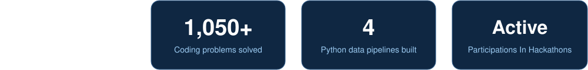
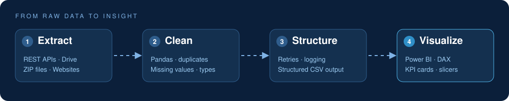

 

## How I Work

## Tech Stack

<table>
  <tr>
    <td><b>Languages</b></td>
    <td>
      
      
      
      
      
    </td>
  </tr>
  <tr>
    <td><b>Data & Analytics</b></td>
    <td>
      
      
      
      
      
      
    </td>
  </tr>
  <tr>
    <td><b>Data Engineering</b></td>
    <td>
      
      
      
      
      
    </td>
  </tr>
  <tr>
    <td><b>Web & Tools</b></td>
    <td>
      
      
      
      
      
    </td>
  </tr>
</table>

## Featured Projects

<table>
  <tr>
    <td width="33%" valign="top">
      <h4>Employee Data Scraping Pipelines</h4>
      Ingests employee records from a REST API, a Google Drive file and a ZIP archive into clean, structured data, with retries, logging and error handling.
        
      
      
      
        
      
    </td>
    <td width="33%" valign="top">
      <h4>BidShield</h4>
      AI-powered platform that automates compliance checks on bid documents and presents verification outcomes for procurement workflows.
        
      
      
        
      
    </td>
    <td width="33%" valign="top">
      <h4>CanteenPulse</h4>
      A canteen and food tracker app for browsing and monitoring food items and orders.
        
      
        
      
    </td>
  </tr>
</table>

Also built: a **Books Analytics** dashboard (~1,000 scraped listings, Power BI with DAX), **Agri-Sense** (crop-disease detection app) and **PharmaGuard** (drug interaction checker).

## Connect with Me

  
  

<i>Open to collaborations. Always learning something new.</i>

